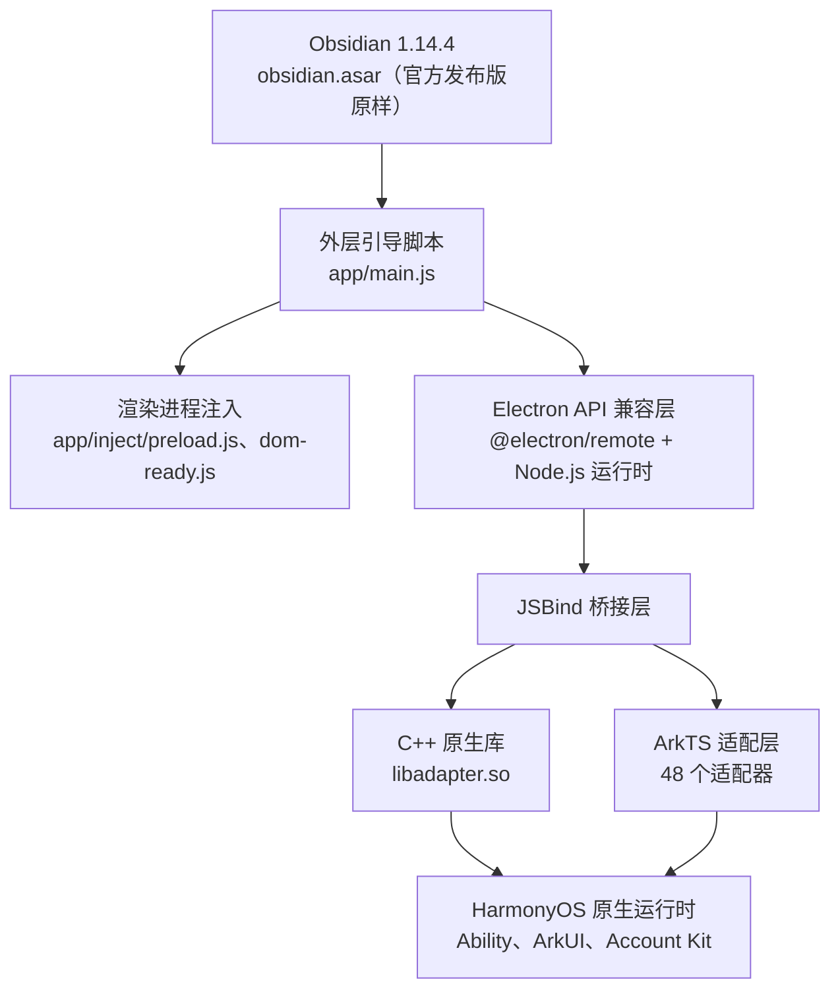

<p align="center">
  
</p>

<h1 align="center">ObsidianHM</h1>

<p align="center">
  <strong>Obsidian for HarmonyOS</strong>
</p>

<p align="center">
  在 HarmonyOS 设备上运行你熟悉的 Obsidian 笔记体验 —— 支持多窗口、华为账号一键登录以及完整的系统级原生适配。
</p>

<p align="center">
  
  
  
</p>

---

## 目录

- [项目简介](#项目简介)
- [技术架构](#技术架构)
- [功能特性](#功能特性)
- [模块结构](#模块结构)
- [适配层](#适配层)
- [定制方式](#定制方式)
- [构建与运行](#构建与运行)
- [项目结构](#项目结构)
- [依赖说明](#依赖说明)
- [文档索引](#文档索引)
- [许可协议](#许可协议)
- [致谢](#致谢)

---

## 项目简介

**ObsidianHM** 是 Obsidian 笔记应用在 HarmonyOS（鸿蒙）平台上的非官方移植项目。它提供一个 Electron 兼容层，让官方发布版 Obsidian（`obsidian.asar`）直接运行在 HarmonyOS 原生运行时之上。

核心思路是：用 HarmonyOS 原生能力提供 Electron API，通过 C++ 原生库（`libadapter.so`）+ ArkTS 适配层 + JSBind 桥接，让 Obsidian 的 Node.js/Electron 运行时在 HarmonyOS 上正常运转。

| 项目信息 | |
|---------|------|
| 应用 ID | `com.mikannqaq.obsidian` |
| 版本号 | 1.14.4.1（versionCode: 11404001） |
| 目标 SDK | HarmonyOS 6.0.2(22) / API 22 |
| 目标设备 | 2in1（折叠屏/平板）、平板 |
| 开发语言 | ArkTS (TypeScript) |
| 构建系统 | Hvigor |
| 内核版本 | Obsidian 1.14.4（`obsidian.asar`，官方发布版原样） |

---

## 技术架构



**分层说明：**

- **Obsidian 层** —— `obsidian.asar`，官方发布版逐字节原样。文件数量、体积与 md5 可用仓库内的校验脚本核验，见「定制方式」
- **外层引导脚本** —— `app/main.js`。加载 asar，承载版本下限短路、remote 提前开启、托盘、关窗最小化到托盘、字体兼容、回收站兼容、deeplink 队列与渲染进程注入
- **渲染进程注入** —— `app/inject/` 下的 `preload.js` 与 `dom-ready.js`，在页面脚本之前或页面就绪之后施加界面调整
- **Electron 兼容层** —— `@electron/remote` 提供 remote 模块 API，`libadapter.so` 提供 Node.js 与系统级 API
- **JSBind 桥接层** —— 连接 JS 运行时与 ArkTS 原生层，把 Electron API 调用转发到对应适配器
- **ArkTS 适配层** —— 48 个适配器，把 HarmonyOS API 包装为 Electron 兼容接口
- **HarmonyOS 底层** —— 系统原生能力：Ability 组件、ArkUI 界面、华为账号等

---

## 功能特性

### Obsidian 核心体验

- 完整的 Obsidian 1.14.4 笔记编辑与管理功能
- 所有社区插件和主题的完整兼容
- 本地 Vault（知识库）的创建、管理与浏览
- Markdown 实时预览与编辑
- 图谱视图、反向链接等高级特性

### 多窗口支持

- 主窗口、子窗口、嵌入窗口、浮动窗口
- 窗口位置与大小持久化记忆
- 独立渲染进程隔离（通过 `ChildProcess`）
- 状态栏扩展窗口

### 华为生态集成

- **华为账号一键登录** —— 通过 Account Kit 的 `LoginWithHuaweiIDButton` 实现无感认证
- **状态栏扩展** —— 通过 `StatusBarViewExtensionAbility` 常驻系统状态栏

### 系统级原生适配

| 类别 | 适配内容 |
|------|---------|
| 文件系统 | 文件管理器、文件选择器、原生对话框、回收站兼容层 |
| 输入 | IME 输入法框架、拖拽放置、多点触控 |
| 显示 | 多显示器管理、深色/浅色主题跟随、自定义光标 |
| 通知 | 系统通知推送、锁屏事件监听 |
| 设备 | 电池状态、蓝牙（经典 + BLE）、电源管理、屏幕截图 |
| 安全 | 证书管理、生物识别认证、剪贴板访问 |
| 其他 | 打印服务、文字转语音、OCR 识别、地理定位、外部协议处理 |

### 自动更新

HarmonyOS 移植版关闭了桌面版的自动更新。外层引导脚本在启动时短路更新检查，并通过 `disable-update` 通道让「关于」页的更新开关保持禁用状态。下载与校验逻辑（RSA-SHA256 签名、SHA256 哈希）仍保留在 `app/main.js` 中，当前不可达。

---

## 模块结构

项目采用 HarmonyOS 标准双模块架构：

### `web_engine`（HAR 静态库）

核心引擎模块，提供全部 Electron 兼容功能与适配层。

```typescript
// 公共导出（Index.ets）
export { WebAbilityStage } from './src/main/ets/application/WebAbilityStage';
export { WebAbility } from './src/main/ets/ability/WebAbility';
export { WebEmbeddedAbility } from './src/main/ets/ability/WebEmbeddedAbility';
export { WebWindow } from './src/main/ets/components/WebWindow';
export { WebSubWindow } from './src/main/ets/components/WebSubWindow';
export { WebEmbeddedWindow } from './src/main/ets/components/WebEmbeddedWindow';
export { WebWindowNode } from './src/main/ets/components/WebWindowNode';
export { ILoginInfo } from './src/main/ets/interface/CommonInterface';
export { ILogin } from './src/main/ets/interface/CommonInterface';
```

另有 `childProcess.ets` 单独导出 `WebChildProcess`。

**依赖注入** —— 使用 InversifyJS 管理适配器的单例注册，注册集中在 `common/CommonModule.ets` 与 `common/AdapterModule.ets`。

### `electron`（HAP 入口包）

可执行的应用模块，包含全部 UI 页面与应用逻辑。

**Ability 组件：**

| Ability | 类型 | 用途 |
|---------|------|------|
| `EntryAbility` | UIAbility | 主入口，初始化 AGC |
| `BrowserAbility` | UIAbility | 浏览器进程窗口 |
| `StatelessAbility` | UIAbility | 无状态窗口 |
| `StatusBarEntryAbility` | ExtensionAbility（`statusBarView`） | 状态栏扩展 |
| `BrowserEmbeddedAbility` | ExtensionAbility（`embeddedUI`） | 嵌入式窗口 |

**UI 页面：**

| 页面 | 说明 |
|------|------|
| `Index.ets` | 主界面，承载 `WebWindow` 组件 |
| `WindowNode.ets` | 浏览器窗口节点，由 `BrowserAbility` 加载 |
| `SubWindow.ets` | 子窗口（弹窗、设置等） |
| `EmbeddedWindow.ets` | 嵌入式窗口，由 `WebEmbeddedAbility` 加载 |
| `Login.ets` | 华为账号登录页 |
| `QuickLoginButtonComponent.ets` | 登录页使用的华为账号一键登录按钮 |
| `StatusBarPage.ets` | 状态栏页面 |
| `WebPage.ets` | 隐私协议等 WebView 页面 |

---

## 适配层

适配层是 ObsidianHM 最重要的基础设施 —— 它把 HarmonyOS 原生 API 包装为 Electron 兼容的调用接口。

### 适配器清单

每个适配器都继承自 `BaseAdapter`，通过 InversifyJS 注册为单例，并配有对应的 JSBind 绑定类：

```
web_engine/src/main/ets/adapter/
├── AccessibilityAdapter.ets         # 无障碍功能
├── AppLifecycleAdapter.ets          # 应用生命周期
├── AppWindowAdapter.ets             # 应用窗口操作
├── BatteryAdapter.ets               # 电池状态
├── BluetoothAdapter.ets             # 蓝牙经典
├── BluetoothLowEnergyAdapter.ets    # 低功耗蓝牙
├── BrowserPolicyAdapter.ets         # 浏览器安全策略
├── CertManagerAdapter.ets           # 证书管理
├── ContextAdapter.ets               # 应用上下文
├── ContextPathAdapter.ets           # 文件路径解析
├── CursorAdapter.ets                # 自定义光标
├── DefaultApplicationAdapter.ets    # 默认应用查询
├── DeviceAdapter.ets                # 设备信息
├── DeviceInfoAdapter.ets            # 硬件信息
├── DeviceUserAuthAdapter.ets        # 生物识别
├── DialogAdapter.ets                # 原生对话框
├── DisplayAdapter.ets               # 显示器管理
├── DragDropAdapter.ets              # 拖拽放置
├── ElectronAppAdapter.ets           # Electron App API
├── ExternalProtocolAdapter.ets      # 外部协议处理
├── FileManagerAdapter.ets           # 文件管理
├── FilePickerAdapter.ets            # 文件选择器
├── FontAdapter.ets                  # 系统字体枚举
├── GeolocationAdapter.ets           # 地理位置
├── I18nAdapter.ets                  # 国际化
├── IMFAdapter.ets                   # 输入法框架
├── MediaAdapter.ets                 # 媒体播放
├── MimeTypeAdapter.ets              # MIME 类型
├── MultiInputAdapter.ets            # 多窗口输入
├── NativeThemeAdapter.ets           # 系统主题
├── NetConnectionAdapter.ets         # 网络连接
├── NotificationAdapter.ets          # 系统通知
├── OcrAdapter.ets                   # OCR 识别
├── PasteBoardApadter.ets            # 剪贴板
├── PermissionManagerAdapter.ets     # 权限管理
├── PopupWindowAdapter.ets           # 弹出窗口
├── PowerMonitorAdapter.ets          # 电源监听
├── PrintAdapter.ets                 # 打印服务
├── ProcessAdapter.ets               # 进程管理
├── RunningLockAdapter.ets           # 唤醒锁
├── ScreenlockMonitorAdapter.ets     # 锁屏监听
├── ScreenshotAdapter.ets            # 屏幕截图
├── ShapeDetectionAdapter.ets        # 形状检测
├── SpeechAdapter.ets                # 文字转语音
├── StatusBarManager.ets             # 状态栏控制
├── SubWindowAdapter.ets             # 子窗口管理
├── SystemFloatingWindowAdapter.ets  # 系统悬浮窗
└── TrashAdapter.ets                # 回收站操作
```

### JSBind 绑定机制

每个适配器配有一个 Bind 类，把方法注册到 JS 运行时：

```typescript
// 示例：剪贴板适配器的 JSBind 注册
JsBindingUtils.bindFunction('PasteBoardAdapter.ReadPasteBoardText', readPasteBoardText);
JsBindingUtils.bindFunction('PasteBoardAdapter.WriteData', writeData);
JsBindingUtils.bindFunction('PasteBoardAdapter.ReadImageBuff', readImageBuff);
// ...
```

全部绑定在应用启动时通过 `jsbindings/JsBindingMethod.ets` 统一激活，当前合计 240 个绑定，分布在 48 个 Bind 类中。

---

## 定制方式

**`obsidian.asar` 保持官方发布版逐字节原样，不施加任何补丁。** 需要对官方行为做改动时，改动一律写进外层运行时：

| 位置 | 承载的改动 |
|------|------------|
| `app/main.js` | 主进程侧的全部改动。版本下限短路、remote 提前开启、托盘、关窗最小化到托盘、字体兼容、回收站兼容、deeplink 队列、日志通道、`PATH` 追加 |
| `app/inject/preload.js` | 渲染进程最早时机的注入。i18n 取词包装、日志转写 |
| `app/inject/dom-ready.js` | 页面就绪后的注入。窗口按钮与右边距、标题栏文字、设置页调整 |

改动注入代码时有三条约束，违反会导致构建通过但运行时报错：

1. **remote 必须在 WebContents 创建时开启。** 用 `app.on('web-contents-created', ...)` 调用 `remote.enable(contents)`，注册位置在 asar 加载之前
2. **覆盖官方同名通道要先 `removeAllListeners`，且代码在 `loadApp()` 之后执行。** 官方的 `ipcMain.on` 全部在 asar 的 `module.exports` 调用的那个函数里
3. **不要覆盖 `window.close`。** 覆盖会作用于每个渲染进程，连带破坏起始窗口关闭、切换仓库、设置弹窗关闭三处

唯一必须的补丁是外层 `package.json` 的 `version` 字段，它决定「关于」页显示的安装版本号。

核验 asar 纯净度：

```bash
node .agents/skills/obsidian-asar-upgrade/scripts/verify-asar.mjs \
  web_engine/src/main/resources/resfile/resources/app/obsidian.asar 1.14.4
```

判断依据逐项记录在 `docs/asar-customization-runtime.md`。

---

## 构建与运行

### 环境要求

| 工具 | 说明 |
|------|------|
| DevEco Studio | 5.0.0+ |
| HarmonyOS SDK | API 22（6.0.2） |
| Node.js | 18.x+ |

### 构建与安装

```bash
devecocli build
devecocli run --skip-build --device <设备序列号>
```

`devecocli` 不在 PATH 时，用 `/storage/Users/currentUser/npm/bin/devecocli`。

构建产物位于 `electron/build/default/outputs/default/`，签名的 HAP 为 `electron-default-signed.hap`。

### 签名配置

`build-profile.json5` 含签名凭据，已被 gitignore。从模板复制后填入自己的值：

```bash
cp build-profile.example.json5 build-profile.json5
```

### 华为 AGC 配置

1. 在 [AppGallery Connect](https://developer.huawei.com/consumer/cn/service/josp/agc/) 创建应用
2. 下载 `agconnect-services.json`，放到 `electron/src/main/resources/rawfile/`，并填入实际的 `client_id`、`app_id`、`api_key` 等字段（仓库内提供 `agconnect-services.example.json` 作为字段模板）
3. 在 `electron/src/main/module.json5` 的 `metadata` 中把 `client_id` 改为该应用的值

### 调试

注入脚本的诊断输出写在应用数据目录的 `obsidian.log`。设备上的 `console.log` 既不进日志文件，也不出现在 hilog 里，因此注入代码统一经 `ohsidian-log` 通道交给主进程写盘。

```bash
hdc shell "tail -n 60 /data/app/el2/100/base/com.mikannqaq.obsidian/files/obsidian.log"
```

日志时间戳是 UTC，北京时间是 UTC+8。日志时间早于进程启动时间时，说明当前运行的进程没有写日志。

---

## 项目结构

```
ObsidianHM/
├── AppScope/                         # 全局应用配置
│   ├── app.json5                     # bundleName、版本、多实例模式
│   └── resources/base/
│       ├── element/string.json       # 应用名称 "Obsidian"
│       ├── media/                    # 应用图标（app_icon、startIcon、tray）
│       └── profile/configuration.json
│
├── web_engine/                       # HAR 静态库（核心引擎）
│   ├── Index.ets                     # 公共 API 导出
│   ├── childProcess.ets              # WebChildProcess 导出
│   ├── oh-package.json5              # 依赖：inversify、reflect-metadata
│   ├── hvigorfile.ts                 # harTasks 构建
│   └── src/main/
│       ├── ets/
│       │   ├── ability/              # WebAbility、WebEmbeddedAbility 等基类
│       │   ├── adapter/              # 48 个系统适配器
│       │   ├── application/          # WebAbilityStage
│       │   ├── common/               # DI 容器、BaseAdapter、管理器
│       │   ├── components/           # WebWindow、WebSubWindow 等 UI 组件
│       │   ├── interface/            # TypeScript 接口定义
│       │   ├── jsbindings/           # JSBind 绑定注册（48 个 Bind 类）
│       │   ├── process/              # WebChildProcess
│       │   └── utils/                # 日志、工具函数
│       ├── cpp/types/libadapter/     # libadapter.so 的类型声明
│       └── resources/resfile/resources/app/   # 外层运行时（Electron 应用目录）
│           ├── main.js               # 外层引导脚本
│           ├── inject/               # 渲染进程注入脚本
│           ├── node_modules/         # @electron/remote，随包发布
│           ├── obsidian.asar         # 官方发布版内核（Git LFS 追踪）
│           ├── package.json          # 外层清单，version 必须与内核版本一致
│           ├── icon.png
│           └── tray.png              # 托盘图标
│
├── electron/                         # HAP 入口模块
│   ├── oh-package.json5              # 依赖：web_engine、AGC hmcore
│   ├── hvigorfile.ts                 # hapTasks 构建
│   ├── libs/arm64-v8a/               # libadapter.so
│   └── src/
│       ├── main/
│       │   ├── module.json5          # 模块清单（Ability、页面、权限）
│       │   ├── ets/
│       │   │   ├── Application/      # AbilityStage
│       │   │   ├── entryability/     # Entry、Browser、Stateless、StatusBar
│       │   │   ├── extensionAbility/ # BrowserEmbeddedAbility
│       │   │   ├── pages/            # UI 页面
│       │   │   ├── process/          # CustomChildProcess
│       │   │   └── utils/            # DeeplinkBridge
│       │   └── resources/
│       │       ├── base/element/     # 字符串资源
│       │       ├── base/profile/     # main_pages 路由配置
│       │       ├── rawfile/          # agconnect-services.json
│       │       └── zh_CN|en_US/element/
│       └── ohosTest/                 # DevEco 脚手架自带的测试模板
│
├── tools/                            # 符号定位工具：从官方 asar 里定位注入点
├── docs/                             # 项目文档，见「文档索引」
├── .agents/skills/                   # 内核升级技能
├── build-profile.example.json5       # 签名配置模板
├── hvigor/                           # Hvigor 构建配置
├── hvigorfile.ts                     # 根构建文件（appTasks）
└── oh-package.json5                  # 根包配置
```

---

## 依赖说明

### 运行时依赖

| 依赖 | 版本 | 说明 |
|------|------|------|
| `inversify` | ^6.0.1 | IoC 容器，管理适配器依赖注入 |
| `reflect-metadata` | ^0.1.13 | TypeScript 装饰器元数据 |
| `@hw-agconnect/hmcore` | ^1.0.1 | 华为 AGC 核心服务 |
| `libadapter.so` | — | C++ 原生适配库（本地引用，预编译） |
| `btime` / `get-fonts` | — | 随包发布的 Node 依赖，位于 `app/node_modules/`，含预编译的 `binding.node` |
| `@electron/remote` | 2.1.3 | Electron remote 模块兼容，位于 `app/node_modules/` |

### 开发依赖

| 依赖 | 版本 | 说明 |
|------|------|------|
| `@ohos/hypium` | 1.0.6 | HarmonyOS 测试框架 |

---

## 文档索引

| 文档 | 内容 |
|------|------|
| `docs/obsidian-internals.md` | 官方内部机制：46 个通道、全局对象、i18n 取词、设置页结构、标题栏、平台差异 |
| `docs/asar-customization-runtime.md` | 每一项定制的归属判定与依据 |
| `docs/asar-upgrade.md` | 内核升级流程与两版差异记录 |
| `docs/runtime-inject-verification.md` | 设备实测记录 |
| `docs/runtime-inject-plan.md` | 运行时注入方案的历史记录 |
| `.agents/skills/obsidian-asar-upgrade/SKILL.md` | 升级内核的完整流程，含注入点与官方接口的对照表 |
| `AGENTS.md` | 仓库级作业约定 |

---

## 许可协议

本项目源码基于 **BSD 3-Clause License**，各源文件头部保留了完整的许可证声明。

```
Copyright (c) 2023-2025, Haitai FangYuan Co., Ltd.
All rights reserved.
```

### 第三方许可

- **Obsidian** 是其各自所有者的商标，本项目为官方发布版 `obsidian.asar` 提供 HarmonyOS 兼容运行环境
- **Electron** 及 `@electron/remote` 遵循 MIT License
- **InversifyJS** 遵循 MIT License
- **Huawei SDK** 各组件遵循华为开发者协议

---

## 致谢

本项目站在以下巨人的肩膀上：

- [Obsidian](https://obsidian.md) — 改变知识管理方式的笔记应用
- [Electron](https://www.electronjs.org) — 跨平台桌面应用框架
- [HarmonyOS](https://developer.huawei.com/consumer/cn/harmonyos/) — 全场景分布式操作系统
- [InversifyJS](https://inversify.io) — 强大的 TypeScript IoC 容器
- [OHSidian](https://github.com/HanversionOvO/OHSidian) — 本项目的原始项目

---

<p align="center">
  <sub>ObsidianHM 是一个社区项目，与 Obsidian 官方无关。</sub>
</p>
