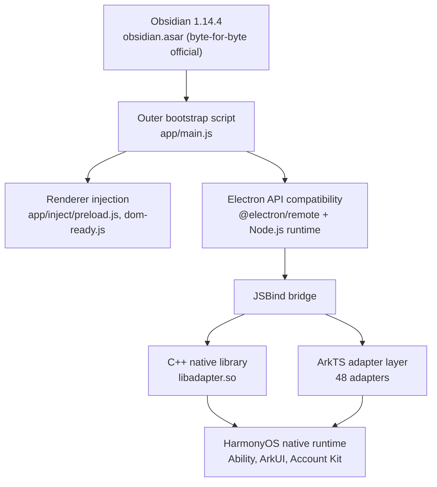

<p align="center">
  
</p>

<h1 align="center">ObsidianHM</h1>

<p align="center">
  <strong>Obsidian for HarmonyOS</strong>
</p>

<p align="center">
  Run the Obsidian note-taking experience you know and love on HarmonyOS devices — with multi-window support, one-tap Huawei Account sign-in, and comprehensive native system integration.
</p>

<p align="center">
  
  
  
</p>

---

## Table of Contents

- [Overview](#overview)
- [Architecture](#architecture)
- [Features](#features)
- [Module Structure](#module-structure)
- [Adapter Layer](#adapter-layer)
- [Customization](#customization)
- [Build & Run](#build--run)
- [Project Structure](#project-structure)
- [Dependencies](#dependencies)
- [Documentation](#documentation)
- [License](#license)
- [Acknowledgments](#acknowledgments)

---

## Overview

**ObsidianHM** is an unofficial port of the Obsidian note-taking application for the HarmonyOS (HongMeng) platform. It provides an Electron compatibility layer so the official release build of Obsidian (`obsidian.asar`) runs directly on the HarmonyOS native runtime.

At its core, ObsidianHM provides the Electron API using HarmonyOS native capabilities. A C++ native library (`libadapter.so`), an ArkTS adapter layer, and a JSBind bridge work together to make Obsidian's Node.js/Electron runtime operate on HarmonyOS.

| Project Info | |
|-------------|------|
| App ID | `com.mikannqaq.obsidian` |
| Version | 1.14.4.1 (versionCode: 11404001) |
| Target SDK | HarmonyOS 6.0.2(22) / API 22 |
| Target Devices | 2in1 (foldable/tablet), Tablet |
| Language | ArkTS (TypeScript) |
| Build System | Hvigor |
| Obsidian Engine | 1.14.4 (`obsidian.asar`, byte-for-byte official release) |

---

## Architecture



**Layers:**

- **Obsidian layer** — `obsidian.asar`, byte-for-byte the official release. File count, size, and md5 can be verified with the script bundled in this repo, see "Customization"
- **Outer bootstrap script** — `app/main.js`. Loads the asar and carries the version-floor short circuit, early remote enable, tray, close-to-tray, font compatibility, trash compatibility, the deeplink queue, and renderer injection
- **Renderer injection** — `preload.js` and `dom-ready.js` under `app/inject/`, applied before page scripts run or once the page is ready
- **Electron compatibility layer** — `@electron/remote` provides the remote module API; `libadapter.so` provides Node.js and system-level APIs
- **JSBind bridge** — connects the JS runtime to the ArkTS native layer, forwarding Electron API calls to the matching adapter
- **ArkTS adapter layer** — 48 adapters wrapping HarmonyOS APIs as Electron-compatible interfaces
- **HarmonyOS foundation** — Ability components, ArkUI, Huawei Account, and other system-native capabilities

---

## Features

### Obsidian Core Experience

- Full Obsidian 1.14.4 note editing and management
- Full compatibility with community plugins and themes
- Creating, managing, and browsing local Vaults
- Live Markdown preview and editing
- Graph view, backlinks, and other advanced features

### Multi-Window Support

- Main, child, embedded, and floating windows
- Window position and size persistence
- Isolated renderer processes (via `ChildProcess`)
- Status bar extension window

### Huawei Ecosystem Integration

- **One-Tap Huawei Account Sign-In** — Seamless authentication via Account Kit's `LoginWithHuaweiIDButton`
- **Status Bar Extension** — Persistent system status bar presence via `StatusBarViewExtensionAbility`

### Native System Integration

| Category | Coverage |
|----------|----------|
| File system | File manager, file picker, native dialogs, trash compatibility layer |
| Input | IME framework, drag and drop, multi-touch |
| Display | Multi-monitor management, dark/light theme following, custom cursors |
| Notifications | System notifications, screen lock event monitoring |
| Device | Battery status, Bluetooth (classic + BLE), power management, screen capture |
| Security | Certificate management, biometric authentication, clipboard access |
| Other | Printing, text-to-speech, OCR, geolocation, external protocol handling |

### Auto-Update

The HarmonyOS port disables desktop auto-update. The outer bootstrap script short-circuits the update check at startup and keeps the toggle on the About page disabled through the `disable-update` channel. The download and verification logic (RSA-SHA256 signature, SHA256 hash) remains in `app/main.js` and is currently unreachable.

---

## Module Structure

The project uses the standard two-module HarmonyOS layout:

### `web_engine` (HAR static library)

The core engine module, providing all Electron compatibility features and the adapter layer.

```typescript
// Public exports (Index.ets)
export { WebAbilityStage } from './src/main/ets/application/WebAbilityStage';
export { WebAbility } from './src/main/ets/ability/WebAbility';
export { WebEmbeddedAbility } from './src/main/ets/ability/WebEmbeddedAbility';
export { WebWindow } from './src/main/ets/components/WebWindow';
export { WebSubWindow } from './src/main/ets/components/WebSubWindow';
export { WebEmbeddedWindow } from './src/main/ets/components/WebEmbeddedWindow';
export { WebWindowNode } from './src/main/ets/components/WebWindowNode';
export { ILoginInfo } from './src/main/ets/interface/CommonInterface';
export { ILogin } from './src/main/ets/interface/CommonInterface';
```

`childProcess.ets` separately exports `WebChildProcess`.

**Dependency injection** — InversifyJS manages adapter singletons; registration lives in `common/CommonModule.ets` and `common/AdapterModule.ets`.

### `electron` (HAP entry module)

The executable application module containing all UI pages and application logic.

**Ability components:**

| Ability | Type | Purpose |
|---------|------|---------|
| `EntryAbility` | UIAbility | Main entry, initializes AGC |
| `BrowserAbility` | UIAbility | Browser process window |
| `StatelessAbility` | UIAbility | Stateless window |
| `StatusBarEntryAbility` | ExtensionAbility (`statusBarView`) | Status bar extension |
| `BrowserEmbeddedAbility` | ExtensionAbility (`embeddedUI`) | Embedded window |

**UI pages:**

| Page | Description |
|------|-------------|
| `Index.ets` | Main interface hosting the `WebWindow` component |
| `WindowNode.ets` | Browser window node, loaded by `BrowserAbility` |
| `SubWindow.ets` | Child windows (popups, settings) |
| `EmbeddedWindow.ets` | Embedded window, loaded by `WebEmbeddedAbility` |
| `Login.ets` | Huawei Account sign-in page |
| `QuickLoginButtonComponent.ets` | The one-tap sign-in button used by the login page |
| `StatusBarPage.ets` | Status bar page |
| `WebPage.ets` | WebView pages such as the privacy policy |

---

## Adapter Layer

The adapter layer is ObsidianHM's most important infrastructure — it wraps HarmonyOS native APIs as Electron-compatible call interfaces.

### Adapter Inventory

Every adapter extends `BaseAdapter`, is registered as a singleton through InversifyJS, and has a matching JSBind class:

```
web_engine/src/main/ets/adapter/
├── AccessibilityAdapter.ets         # Accessibility
├── AppLifecycleAdapter.ets          # Application lifecycle
├── AppWindowAdapter.ets             # Application window operations
├── BatteryAdapter.ets               # Battery status
├── BluetoothAdapter.ets             # Bluetooth classic
├── BluetoothLowEnergyAdapter.ets    # Bluetooth low energy
├── BrowserPolicyAdapter.ets         # Browser security policy
├── CertManagerAdapter.ets           # Certificate management
├── ContextAdapter.ets               # Application context
├── ContextPathAdapter.ets           # File path resolution
├── CursorAdapter.ets                # Custom cursors
├── DefaultApplicationAdapter.ets    # Default application lookup
├── DeviceAdapter.ets                # Device information
├── DeviceInfoAdapter.ets            # Hardware information
├── DeviceUserAuthAdapter.ets        # Biometric authentication
├── DialogAdapter.ets                # Native dialogs
├── DisplayAdapter.ets               # Display management
├── DragDropAdapter.ets              # Drag and drop
├── ElectronAppAdapter.ets           # Electron App API
├── ExternalProtocolAdapter.ets      # External protocol handling
├── FileManagerAdapter.ets           # File management
├── FilePickerAdapter.ets            # File picker
├── FontAdapter.ets                  # System font enumeration
├── GeolocationAdapter.ets           # Geolocation
├── I18nAdapter.ets                  # Internationalization
├── IMFAdapter.ets                   # Input method framework
├── MediaAdapter.ets                 # Media playback
├── MimeTypeAdapter.ets              # MIME types
├── MultiInputAdapter.ets            # Multi-window input
├── NativeThemeAdapter.ets           # System theme
├── NetConnectionAdapter.ets         # Network connectivity
├── NotificationAdapter.ets          # System notifications
├── OcrAdapter.ets                   # OCR
├── PasteBoardApadter.ets            # Clipboard
├── PermissionManagerAdapter.ets     # Permission management
├── PopupWindowAdapter.ets           # Popup windows
├── PowerMonitorAdapter.ets          # Power monitoring
├── PrintAdapter.ets                 # Printing
├── ProcessAdapter.ets               # Process management
├── RunningLockAdapter.ets           # Wake lock
├── ScreenlockMonitorAdapter.ets     # Screen lock monitoring
├── ScreenshotAdapter.ets            # Screen capture
├── ShapeDetectionAdapter.ets        # Shape detection
├── SpeechAdapter.ets                # Text-to-speech
├── StatusBarManager.ets             # Status bar control
├── SubWindowAdapter.ets             # Child window management
├── SystemFloatingWindowAdapter.ets  # System floating windows
└── TrashAdapter.ets                # Trash operations
```

### JSBind Registration

Each adapter has a Bind class that registers its methods into the JS runtime:

```typescript
// Example: clipboard adapter JSBind registration
JsBindingUtils.bindFunction('PasteBoardAdapter.ReadPasteBoardText', readPasteBoardText);
JsBindingUtils.bindFunction('PasteBoardAdapter.WriteData', writeData);
JsBindingUtils.bindFunction('PasteBoardAdapter.ReadImageBuff', readImageBuff);
// ...
```

All bindings are activated at startup through `jsbindings/JsBindingMethod.ets`. There are currently 240 bindings across 48 Bind classes.

---

## Customization

**`obsidian.asar` stays byte-for-byte the official release, with no patches applied.** When official behavior needs to change, the change goes into the outer runtime instead:

| Location | What it carries |
|----------|-----------------|
| `app/main.js` | All main-process changes. Version-floor short circuit, early remote enable, tray, close-to-tray, font compatibility, trash compatibility, the deeplink queue, the log channel |
| `app/inject/preload.js` | Earliest renderer injection. i18n lookup wrapping, log forwarding |
| `app/inject/dom-ready.js` | Post-ready injection. Window buttons and right margin, titlebar text, settings page adjustments |

Three constraints apply when changing injection code. Violating any of them builds successfully but fails at runtime:

1. **remote must be enabled when the WebContents is created.** Call `remote.enable(contents)` from `app.on('web-contents-created', ...)`, registered before the asar is loaded
2. **Overriding an official channel requires `removeAllListeners` first, and the code must run after `loadApp()`.** The official `ipcMain.on` calls all live inside the function that the asar's `module.exports` invokes
3. **Do not override `window.close`.** The override applies to every renderer process and breaks three things: closing the starter window, switching vaults, and closing the settings popup

The only required patch is the `version` field in the outer `package.json`, which determines the installer version shown on the About page.

Verify asar purity:

```bash
node .agents/skills/obsidian-asar-upgrade/scripts/verify-asar.mjs \
  web_engine/src/main/resources/resfile/resources/app/obsidian.asar 1.14.4
```

Per-item decisions are recorded in `docs/asar-customization-runtime.md`.

---

## Build & Run

### Requirements

| Tool | Notes |
|------|-------|
| DevEco Studio | 5.0.0+ |
| HarmonyOS SDK | API 22 (6.0.2) |
| Node.js | 18.x+ |

### Build and Install

```bash
devecocli build
devecocli run --skip-build --device <device-serial>
```

If `devecocli` is not on PATH, use `/storage/Users/currentUser/npm/bin/devecocli`.

Build output lands in `electron/build/default/outputs/default/`; the signed HAP is `electron-default-signed.hap`.

### Signing Configuration

`build-profile.json5` contains signing credentials and is gitignored. Copy the template and fill in your own values:

```bash
cp build-profile.example.json5 build-profile.json5
```

### Huawei AGC Setup

1. Create an application in [AppGallery Connect](https://developer.huawei.com/consumer/cn/service/josp/agc/)
2. Download `agconnect-services.json` into `electron/src/main/resources/rawfile/` and fill in the actual `client_id`, `app_id`, `api_key`, and related fields (`agconnect-services.example.json` in the repo serves as a field template)
3. Change `client_id` in the `metadata` block of `electron/src/main/module.json5` to the value for that application

### Debugging

Diagnostic output from the injection scripts is written to `obsidian.log` in the application data directory. On device, `console.log` reaches neither the log file nor hilog, so injection code writes through the `ohsidian-log` channel to the main process instead.

```bash
hdc shell "tail -n 60 /data/app/el2/100/base/com.mikannqaq.obsidian/files/obsidian.log"
```

Log timestamps are UTC; Beijing time is UTC+8. If the newest log entry predates the process start time, the running process has not written any log.

---

## Project Structure

```
ObsidianHM/
├── AppScope/                         # Global application config
│   ├── app.json5                     # bundleName, version, multi-instance mode
│   └── resources/base/
│       ├── element/string.json       # Application name "Obsidian"
│       ├── media/                    # App icons (app_icon, startIcon, tray)
│       └── profile/configuration.json
│
├── web_engine/                       # HAR static library (core engine)
│   ├── Index.ets                     # Public API exports
│   ├── childProcess.ets              # WebChildProcess export
│   ├── oh-package.json5              # Deps: inversify, reflect-metadata
│   ├── hvigorfile.ts                 # harTasks build
│   └── src/main/
│       ├── ets/
│       │   ├── ability/              # WebAbility, WebEmbeddedAbility base classes
│       │   ├── adapter/              # 48 system adapters
│       │   ├── application/          # WebAbilityStage
│       │   ├── common/               # DI container, BaseAdapter, managers
│       │   ├── components/           # WebWindow, WebSubWindow, and other UI components
│       │   ├── interface/            # TypeScript interface definitions
│       │   ├── jsbindings/           # JSBind registration (48 Bind classes)
│       │   ├── process/              # WebChildProcess
│       │   └── utils/                # Logging and utilities
│       ├── cpp/types/libadapter/     # Type declarations for libadapter.so
│       └── resources/resfile/resources/app/   # Outer runtime (Electron app directory)
│           ├── main.js               # Outer bootstrap script
│           ├── inject/               # Renderer injection scripts
│           ├── node_modules/         # @electron/remote, shipped with the package
│           ├── obsidian.asar         # Official engine (tracked by Git LFS)
│           ├── package.json          # Outer manifest; version must match the engine
│           ├── icon.png
│           └── tray.png              # Tray icon
│
├── electron/                         # HAP entry module
│   ├── oh-package.json5              # Deps: web_engine, AGC hmcore
│   ├── hvigorfile.ts                 # hapTasks build
│   ├── libs/arm64-v8a/               # libadapter.so
│   └── src/
│       ├── main/
│       │   ├── module.json5          # Module manifest (abilities, pages, permissions)
│       │   ├── ets/
│       │   │   ├── Application/      # AbilityStage
│       │   │   ├── entryability/     # Entry, Browser, Stateless, StatusBar
│       │   │   ├── extensionAbility/ # BrowserEmbeddedAbility
│       │   │   ├── pages/            # UI pages
│       │   │   ├── process/          # CustomChildProcess
│       │   │   └── utils/            # DeeplinkBridge
│       │   └── resources/
│       │       ├── base/element/     # String resources
│       │       ├── base/profile/     # main_pages routing config
│       │       ├── rawfile/          # agconnect-services.json
│       │       └── zh_CN|en_US/element/
│       └── ohosTest/                 # Test templates from the DevEco scaffold
│
├── tools/                            # Symbol resolver: locates injection points in the official asar
├── docs/                             # Project documentation, see "Documentation"
├── .agents/skills/                   # Engine upgrade skill
├── build-profile.example.json5       # Signing config template
├── hvigor/                           # Hvigor build config
├── hvigorfile.ts                     # Root build file (appTasks)
└── oh-package.json5                  # Root package config
```

---

## Dependencies

### Runtime Dependencies

| Dependency | Version | Notes |
|------------|---------|-------|
| `inversify` | ^6.0.1 | IoC container managing adapter injection |
| `reflect-metadata` | ^0.1.13 | TypeScript decorator metadata |
| `@hw-agconnect/hmcore` | ^1.0.1 | Huawei AGC core services |
| `libadapter.so` | — | C++ native adapter library (local reference, prebuilt) |
| `btime` / `get-fonts` | — | Node dependencies shipped with the package under `app/node_modules/`, with prebuilt `binding.node` binaries |
| `@electron/remote` | 2.1.3 | Electron remote compatibility, under `app/node_modules/` |

### Development Dependencies

| Dependency | Version | Notes |
|------------|---------|-------|
| `@ohos/hypium` | 1.0.6 | HarmonyOS test framework |

---

## Documentation

| Document | Contents |
|----------|----------|
| `docs/obsidian-internals.md` | Official internals: the 44 channels, global objects, i18n lookup, settings page structure, titlebar, platform differences |
| `docs/asar-customization-runtime.md` | Per-item customization decisions and their basis |
| `docs/asar-upgrade.md` | Engine upgrade procedure and the recorded differences between versions |
| `docs/runtime-inject-verification.md` | On-device verification records |
| `docs/runtime-inject-plan.md` | Historical record of the runtime injection plan |
| `.agents/skills/obsidian-asar-upgrade/SKILL.md` | The full engine upgrade procedure, including the injection-point reference table |
| `AGENTS.md` | Repository-level working conventions |

---

## License

The source code of this project is under the **BSD 3-Clause License**. Each source file retains the full license header.

```
Copyright (c) 2023-2025, Haitai FangYuan Co., Ltd.
All rights reserved.
```

### Third-Party Licenses

- **Obsidian** is a trademark of its respective owner; this project provides a HarmonyOS runtime environment for the official `obsidian.asar`
- **Electron** and `@electron/remote` are under the MIT License
- **InversifyJS** is under the MIT License
- **Huawei SDK** components are subject to the Huawei Developer Agreement

---

## Acknowledgments

This project stands on the shoulders of giants:

- [Obsidian](https://obsidian.md) — the note-taking app that changed knowledge management
- [Electron](https://www.electronjs.org) — the cross-platform desktop application framework
- [HarmonyOS](https://developer.huawei.com/consumer/cn/harmonyos/) — the all-scenario distributed operating system
- [InversifyJS](https://inversify.io) — a powerful TypeScript IoC container
- [OHSidian](https://github.com/HanversionOvO/OHSidian) — the original project this work is based on

---

<p align="center">
  <sub>ObsidianHM is a community project, unaffiliated with Obsidian officially.</sub>
</p>
