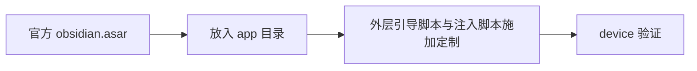

<!-- Copyright (c) 2026 HandwerSTD -->

# ObsidianHM asar 升级

## 1. 概述

项目使用官方发布版 asar 原样，定制由外层运行时注入施加，判定依据与最终状态见 `docs/asar-customization-runtime.md`，实测记录见 `docs/runtime-inject-verification.md`。

本文件保留升级过程中积累的资料：第 2 节的素材来源、第 3 节的官方两版差异（文件清单、通道增删、导出接口、设置页重构、许可证模块）、第 4 节的 1.12.7 旧定制清单、第 6 节的升级步骤与第 7 节的验证方式。

ObsidianHM 是 Obsidian 的 HarmonyOS 移植。桌面内核取自官方发布版 `obsidian.asar`，外层引导脚本为 `web_engine/src/main/resources/resfile/resources/app/main.js`。

仓库内的 asar 由 Git LFS 追踪（`.gitattributes` 中有 `*.asar filter=lfs`），提交路径为 `web_engine/src/main/resources/resfile/resources/app/obsidian.asar`。当前该文件是官方 1.14.4 原版，md5 `a2bde3f94594c1d697492998ea6e20aa`。



## 2. 素材与工具

### 官方素材

素材位于 `~/Download/com.huawei.hmos.browser/obsidian/` 下：

| 代号 | 路径 | 是什么 |
|------|------|--------|
| gz12 | `gz12/obsidian.asar` | 官方 1.12.7 发布版 asar，24060763 字节 |
| gz13 | `gz13/obsidian.asar` | 官方 1.13.4 发布版 asar，25783388 字节 |
| obs-ext-12 | `obs-ext-12/obsidian-1.12.7.asar.gz` | 1.12.7 asar 的压缩件 |
| obs-ext-12 | `obs-ext-12/obsidian-1.12.7-arm64.tar.gz` | 1.12.7 Linux arm64 完整安装包 |
| obs-ext-13 | `obs-ext-13/obsidian-1.13.4.asar.gz` | 1.13.4 asar 的压缩件 |
| obs-ext-13 | `obs-ext-13/obsidian-1.13.4-arm64.tar.gz` | 1.13.4 Linux arm64 完整安装包 |
| tar12 | `tar12/obsidian-1.12.7-arm64/` | 1.12.7 安装包的解压结果，`resources/` 下有 `obsidian.asar` |
| tar13 | `tar13/obsidian-1.13.4-arm64/` | 1.13.4 安装包的解压结果，`resources/` 下有 `obsidian.asar` |
| v144 | `obsidian-extracted/resources/` | 1.14.4 的 `obsidian.asar`（27477966 字节）、`app.asar`、`app.asar.unpacked` |

取得官方 asar 的方式：`.asar.gz` 压缩件先用 `gzip -dc` 解出 `.asar`，再用 `@electron/asar` 的 `extract` 子命令解包。完整安装包的 `resources/` 下也带 `obsidian.asar`、`app.asar` 与 `icon.png`。

发布版 asar 与安装包里的两份 asar 是不同文件：`obsidian.asar` 是应用主体，`app.asar` 是外层加载器，不要混用。

升级到 1.14.4 时可直接使用 `obsidian-extracted/resources/obsidian.asar`，无需先取得 tar 安装包。

### 解包工具

`@electron/asar` 的 `extract` 子命令：

```bash
node_modules/.bin/asar extract <asar 文件> <输出目录>
```

`tools/package.json` 已包含该依赖，直接使用 `tools/node_modules/.bin/asar`。

`tools/resolve-symbols.mjs` 从官方 asar 里定位注入需要的符号，用法见第 6 节。

### 产物对比

对比压缩后的单行产物时，需要先按分号切片再做行级比较。直接对整行做 `difflib` 会长时间没有输出。

对 200 KB 以上的 `main.js`（例如官方 1.14.4 的压缩版本），压缩后的变量名整体重排会使行级相似度降到 0.07 附近，逐块对齐不可靠，此时改用关键标识符的存在情况与出现次数对比。

## 3. 官方 1.12.7 与 1.13.4 的差异

| 项 | 1.12.7 | 1.13.4 |
|----|--------|--------|
| 文件数 | 352 | 358（新增 `lib/defuddle.full.js` 750220 字节与 5 个 `.DS_Store`） |
| `main.js` | 60101 字节 | 200349 字节 |
| `app.js` | 3728534 字节 | 3874103 字节 |
| `app.css` | 600413 字节 | 634971 字节 |
| `package.json` version | 1.12.7 | 1.13.4 |
| `ipcMain.on` 通道数 | 41 | 44 |
| `module.exports` 签名 | `function(c,i,l)` | `function(i,e)` |

两版未删除任何文件。`require` 的模块集合完全相同，都是 `child_process`、`electron`、`fs`、`net`、`original-fs`、`os`、`path`、`url`、`util`。

1.14.4 相对 1.13.4 的同项取值：文件数 396，`main.js` 203702 字节，`app.js` 3942126 字节，`app.css` 668223 字节，`package.json` version `1.14.4`，`ipcMain.on` 通道数 46。`require` 的模块集合多了 `crypto`，`module.exports` 签名仍为两个参数。

### main.js 的通道增删

| 集合 | 通道 |
|------|------|
| 仅 1.12.7 有 | `is-dev` |
| 仅 1.13.4 有 | `is-closing`、`policy`、`set-language`、`terms` |
| 仅 1.14.4 有（相对 1.13.4） | `latest-public-version`、`open-file` |

1.13.4 新增 `policy.json` 读取逻辑，用于企业策略配置（`plugins`、`themes`、`snippets`、`sync`、`publish`、`webViewer`、`devTools`、`insider` 八项开关）。HarmonyOS 上 `/etc/<app 名>/policy.json` 不存在，读取失败后走默认值，八项全部关闭。

`latest-public-version` 是 1.14.4 新增的事件监听，外层可用它取远端最新公开版本，`UpdateChecker` 未使用它。`open-file` 是 macOS 上的「用本应用打开文件」，由 `will-finish-launching` 里的 `app.once` 注册，也只在那个分支里有意义。

`adblock` 相关标识符两版都是 14 处，`vault-move` 通道两版都有。

### 模块导出接口

外层加载器 `loadApp` 只传两个参数（`asarPath` 与 `updateEvents`）。1.13.4 的 `module.exports` 参数个数由三个变为两个，与调用方式兼容。1.12.7 的第三个参数在官方实现中未被使用。

官方两版的外层加载器 `loadApp` 逻辑相同，唯一差别是错误日志：1.13.4 在 `catch` 里多了 `log('Failed to load app', asarPath, e)`。

### 设置页重构

1.13.4 把设置页从「在 `display()` 里逐项 `addSetting`」改为「实现 `getSettingDefinitions()` 返回定义数组」，基类的 `update()` 负责渲染。

| 统计项 | 1.12.7 | 1.13.4 |
|--------|--------|--------|
| `getSettingDefinitions` 出现次数 | 0 | 23 |
| `prototype.display=function` 出现次数 | 29 | 11 |
| `t.push({name:` 出现次数 | 5 | 44 |
| `s.addSetting(` 出现次数 | 6 | 1 |
| `v.addSetting(` 出现次数 | 6 | 0 |

账户区段的写法随之改变。1.12.7 为：

```js
d.addSetting(function(t) { return e.accountSetting = t, t }),
d.addSetting(function(t) { return e.catalystSetting = t, t }),
d.addSetting(function(t) { return e.commercialLicenseSetting = t, t })
```

1.13.4 为：

```js
t.push({ type: "group", heading: Ree.name(), items: [
    { name: Ree.optionYourAccount(), render: function(t) { e.accountSetting = t } },
    { name: Fee.optionCatalyst(), render: function(t) { e.catalystSetting = t } },
    { name: Ree.optionCommercialLicense(), render: function(t) {
        e.commercialLicenseSetting = t, e.updateAccountSettings(), ... } }
]})
```

版本项与自动更新项在 1.13.4 中分成两条 `t.push`，渲染逻辑移到独立的 `updateVersionSetting` 方法；1.12.7 把它们内联在 `display()` 里。两版使用的 i18n 键一致（`labelNewVersionReady`、`labelManualUpdateRequired`、`labelReadChangelog`、`buttonRelaunch`、`buttonCheckForUpdates`、`labelInstallVersion`、`labelVersion`）。

`insider build` 设置项两版都有（`optionInsiderBuild` 各出现 2 次，`insider-build` 各 4 次），1.13.4 的开关受 `xb.insider` 与 `Ok.license` 双重控制。

### 许可证模块

1.13.4 删除了本地商业许可证状态单例。`Hw` 这个名字被复用为 `Symbol("customKeys")`（`Hw = Qw`、`Qw = Symbol("customKeys")`），与许可证不再相关。许可证状态改名为 `Ok`，并与服务端查询绑定。

| 调用 | 1.12.7 | 1.13.4 |
|------|--------|--------|
| `Hw.license` | 5 | 0 |
| `Hw.key` | 6 | 0 |
| `getUserInfo` | 0 | 4 |
| `checkBizKey` | 0 | 3 |

1.13.4 在 `render` 里调用 `Ok.getUserInfo()` 与 `Ok.checkBizKey()` 向服务端查询，并在 `updateAccountSettings` 里按 `Ok.key` 分支渲染。激活弹窗类由 `B7` 改为 `Vee`。i18n 的 `setting.account` 区段键名两版相同：`optionCommercialLicense`、`optionCommercialLicenseDesc`、`labelYourCommercialLicenseKey`、`labelCommercialLicenseInfo`、`labelValidatingCommercialLicense`、`labelInvalidCommercialLicense`、`buttonActivate`、`buttonPurchase`、`buttonRemoveCommercialLicense` 都存在。

i18n 访问器在压缩产物里的名字两版不同：1.12.7 用 `O7`（about）与 `F7`（account），1.13.4 用 `Fee`（about）与 `Ree`（account）。补丁按方法名与字符串定位，不按这些名字定位。

### starter CSS

1.13.4 中 `.starter.is-hidden-frameless .titlebar` 选择器不再存在，同一条规则被并入复合选择器：

```css
body.is-frameless.is-hidden-frameless.starter .titlebar,
body.is-frameless.is-hidden-frameless.is-popout-modal:not(.is-fullscreen) .titlebar,
body.is-frameless:not(.is-hidden-frameless, .is-fullscreen) .titlebar {
  height: var(--titlebar-height);
  zoom: calc(1 / var(--zoom-factor));
}
```

`.starter` 与 `.starter .titlebar` 两条规则在 1.13.4 中仍然存在，后者的内容为 `background-color: transparent; border: none;`。

### 未改动的公共文件

`enhance.js` 两版 md5 相同，为 `fb7a3408e1b0d75662897444e8cd86da`；`sim.js` 两版 md5 相同，为 `12d22674f0ce5cabd62a5613df8b91c6`。仓库未改动 `lib/` 目录下 254 个文件中的任何一个。

## 4. 仓库定制完整清单

本节是仓库在 1.12.7 上做过的全部改动，作为升级时的原始依据。每一项在当前版本下的归属决策见 `docs/asar-customization-runtime.md`。

### 4.1 文件树差异

仓库相对官方 1.12.7 多出 3 个文件，没有缺少任何文件。

| 新增文件 | 字节数 |
|---------|-------|
| `harmonyos-sync-bridge.js` | 1785 |
| `icon.png.bak` | 29937 |
| `tray.png` | 314843 |

同名文件中有 11 个内容不同，其余 341 个 md5 完全相同。

| 文件 | 官方 1.12.7 | 仓库 1.12.7 |
|------|------------|------------|
| `app.css` | 600413 | 600383 |
| `app.js` | 3728534 | 3733193 |
| `help.html` | 565 | 565 |
| `i18n.js` | 129239 | 129134 |
| `i18n/zh.txt` | 69022 | 68956 |
| `icon.png` | 29937 | 1606146 |
| `index.html` | 1445 | 1445 |
| `main.js` | 60101 | 66141 |
| `package.json` | 260 | 278 |
| `starter.html` | 568 | 568 |
| `starter.js` | 416521 | 410292 |

### 4.2 main.js 在 1.12.7 上的改动（10 处）

以下 10 处已全部迁移到 1.13.4，见 4.10 节。第 1 处的 `vault-move` 删除未随迁，见 4.11 节。

1. 新增 12 个 `hcs-*` 通道：`hcs-get-status`、`hcs-sync-all`、`hcs-get-auto-sync`、`hcs-set-auto-sync`、`hcs-get-excluded`、`hcs-set-excluded`、`hcs-get-userid`、`hcs-set-userid`、`hcs-login`、`hcs-restore-list`、`hcs-restore-file`、`hcs-code`。1.12.7 上插在 `ipcMain.on("vault-move",...)` 与 `ipcMain.on("vault-open",...)` 之间，同时删除了 `vault-move`；1.13.4 上插在 `vault-open` 之前，`vault-move` 保留。
2. 新增 `exit-to-tray` 与 `force-quit` 两个通道。`exit-to-tray` 读写托盘开关状态，`force-quit` 关闭托盘开关后调用 `app.quit()`。插入位置在 `ipcMain.on("relaunch",...)` 之前。
3. 托盘初始化：`app.whenReady()` 回调开头用 `Tray` 加载 `tray.png`，单击切换窗口显示状态，右键菜单为 `显示` 与 `退出软件`。
4. 关窗最小化到托盘：仓库窗口的 `close` 事件开头插入判断，托盘开关开启且非真正退出时调用 `preventDefault()` 并隐藏窗口。
5. 新增 `app.on("before-quit",()=>{isQt=!0})`，用于区分真正退出与关窗到托盘。插入位置在 `app.on("window-all-closed",...)` 之前。
6. help 窗口复用 starter 窗口。插入位置在 `function Ye()`（help 打开函数）内。
7. starter 窗口复用为仓库窗口。插入位置在 `let ke=()=>{...}`（启动时按目录结构打开仓库窗口）内。
8. 打开最近仓库时复用 starter 窗口，`function de(t)` 的两个分支都插入这段代码。
9. `starter` 与 `help` 两个通道改为按 `BrowserWindow.fromWebContents(t.sender)` 定位窗口并加载对应页面，全局打开函数只作为兜底。
10. 短路 Electron 版本下限检查：`if(Mt<18){` 改为 `if(false&&Mt<18){`，去掉「必须手动下载安装」的强制弹窗。

### 4.3 app.js 在 1.12.7 上的改动（8 处）

第 1 处、第 5 处至第 7 处已迁移到 1.13.4；第 2 处至第 4 处与第 8 处未迁移，见 4.11 节。

1. 标题栏处理：在 `e.parent===e` 分支内调用 `electronWindow.setWindowButtonVisibility("hidden"===t)`，并在 `"hidden"===t` 时把 `--frame-right-space` 设为 `126px`。
2. 「关于」页版本项：去掉更新下载与检查更新分支，把描述改为静态的版本号与安装程序版本，并新增一项「贡献作者」，内容为 `@MikannQAQ` 与仓库地址按钮。
3. 商业许可证项改名「社区许可证」，无 key 时描述改为「该版本由社区进行移植为HarmonyOS版本，无需进行激活」，按钮文案改为「详情」。
4. 许可证激活弹窗改为静态说明弹窗：标题为「社区许可证」，内容说明该版本为 HarmonyOS 社区移植版本、无需许可证激活，只有一个「确定」按钮。
5. 「外观」页在自定义图标按钮之后、`translucency` 项之前插入开关「退出软件」，描述为「开启后，点击关闭按钮不会退出软件，需在托盘中退出软件」，状态经 `exit-to-tray` 通道同步给主进程。
6. 新增 `HcsSettingsTab` 类，即「华为云同步」设置页（`id = "huawei-cloud-sync"`，`name = "华为云同步"`，`icon = "cloud"`）。插入位置在核心插件设置页类结束、设置弹窗类开始处。
7. 注册 `HcsSettingsTab`：在社区插件设置页注册之后追加 `n.addSettingTab(new HcsSettingsTab(t,n))`。
8. 最低 installer 版本 `yte` 由 `"28.2.3"` 改为 `"1.12.7"`。

### 4.4 starter.js 在 1.12.7 上的改动（5 处）

第 1 处与第 3 处至第 5 处已迁移；第 2 处（品牌 logo 与字标改写）未迁移，见 4.11 节。

1. 标题栏文字由 `Obsidian` 改为 `OHsidian`（当时的项目名称）。
2. 品牌 logo 与字标的两段内联 SVG 改为 `icon.png` 图片与 `OHsidian`（当时的项目名称）文本。
3–5. 删除全部 5 处 `window.close()`，打开或创建仓库后不再自动关窗。

### 4.5 i18n.js（7 个键）

| key | 官方 1.12.7 | 仓库 |
|-----|------------|------|
| `labelVersion` | `"Version {{version}}"` | `"HarmonyOS-{{version}}"` |
| `labelInstallVersion` | `"Installer version: {{version}}"` | `"HarmonyOS Port {{version}}"` |
| `labelReadChangelog` | `"Read the changelog."` | `""` |
| `labelManualUpdateRequired` | `"To support the latest features and to receive the latest security patches, Obsidian needs a major installer update. You need to manually download and reinstall Obsidian."` | `"This is a HarmonyOS port. Original update channels are not available."` |
| `labelDisabledUpdates` | `"Updates are disabled."` | `"Updates are disabled. Running on HarmonyOS."` |
| `buttonCheckForUpdates`（account 区段） | `"Check for updates"` | `"Updates not available"` |
| `optionAutoUpdateDescription` | `"Turn this off to prevent the app from checking for updates."` | `"Automatic updates are disabled on HarmonyOS port."` |

两版 `i18n.js` 各有 2315 个 `key:"..."` 项，值不同的只有这 7 个，都位于 `setting.about` / `setting.account`。`buttonCheckForUpdates` 在多个区段同名出现，`setting.about` 之外的值两版相同。

### 4.6 i18n/zh.txt（4 块，共 7 行）

改动集中在「关于」页的更新相关文案，对应 1.12.7 的 277–286 行、1.13.4 的 304–313 行：

| 项 | 官方 1.12.7 | 仓库 |
|----|------------|------|
| `版本 {{version}}` | 同左 | `HarmonyOS-{{version}}` |
| `安装程序版本: {{version}}` | 同左 | `HarmonyOS 移植版本 {{version}}` |
| `阅读更新日志` | 同左 | 空行 |
| 手动下载安装说明 | `Obsidian 需要进行一次较大的更新来获取最新功能和安全补丁。为此，你需要手动下载安装包并重新安装 Obsidian。` | `此版本为 HarmonyOS 移植版，原有更新通道不可用。` |
| `更新已禁用。` | 同左 | `更新已禁用（HarmonyOS 移植版）。` |
| `检查更新` | 同左 | `更新不可用` |
| `关闭后 Obsidian 将不会自动更新。` | 同左 | `HarmonyOS 移植版不支持自动更新。` |

### 4.7 app.css（3 处）

1. `.starter.is-hidden-frameless .titlebar` 的 `display: block` 改为 `display: none`。
2. `.starter` 的 `padding-top: 0! important` 改为 `padding-top: 30px! important`。
3. `.starter .titlebar` 的 `background-color: transparent; border: none;` 改为 `display: none`。

### 4.8 三个 HTML 与 package.json

`index.html`、`starter.html`、`help.html` 的 `<title>Obsidian</title>` 各改为 `<title>OHsidian</title>`，三个文件字节数不变。

`package.json` 改两个字段：

| 字段 | 官方 1.12.7 | 仓库 |
|------|------------|------|
| `author` | `"Obsidian"` | `"OHsidian"` |
| `description` | `"Obsidian"` | `"OHsidian HarmonyOS Edition"` |

其余字段两版相同：`name`（`obsidian-dev`）、`version`（随版本）、`license`（`UNLICENSED`）、`private`（true）、`main`（`index.js`）、`dependencies`（`btime` 与 `get-fonts` 指向 `../electron/*`）。

### 4.9 图标与新增资源

- `icon.png` 替换为 1606146 字节的自定义图标，官方原图重命名保留为 `icon.png.bak`。
- 新增 `tray.png`（314843 字节），供托盘初始化使用。
- 新增 `harmonyos-sync-bridge.js`（1785 字节）：独立 CommonJS 模块，导出 `HmosSyncBridge`（`resolveVaultPath` 读 `obsidian.json` 定位仓库路径，日志前缀 `[HMOS-SYNC]`）。该文件在 asar 内无任何引用。

当前构建脚本只携带 `tray.png`，不携带 `icon.png.bak` 与 `harmonyos-sync-bridge.js`。

### 4.10 各项定制当前的归属

以下内容在 1.13.4 上的归属已逐项判定，详细依据见 `docs/asar-customization-runtime.md`。

| 来源 | 归属 |
|------|------|
| `main.js` | 4.2 节的 10 处，全部改由外层引导脚本承载 |
| `app.js` | 窗口按钮处理、设置页封装改由注入脚本承载 |
| `starter.js` | 标题栏文字与 HTML 标题改为采用官方值；5 处 `window.close()` 保留官方语义 |
| `i18n.js` / `i18n/zh.txt` | 由 `inject/preload.js` 包装 `i18next.t` 承载 |
| `app.css` | 起始窗口样式由 `inject/dom-ready.js` 插入样式承载 |
| 三个 HTML | 标题采用官方值，不再改写 |
| `package.json` | 仅保留 `version` 字段，`author` 与 `description` 采用官方值 |
| 资源 | `icon.png` 采用官方原图；`tray.png` 新增 |

### 4.11 已放弃的作者自定义内容

以下改动存在于 1.12.7 的仓库版，属于产品层面的改写，当前不再保留：

- 商业许可证项改名「社区许可证」及其描述改写。
- 许可证激活弹窗改为静态说明弹窗。
- 「关于」页里 installer 版本标识的改写。该值参与 `return!qy(<版本>,<该值>)` 的判断，影响「关于」页是否提示安装程序过旧。当前改为短路 `disable-update` 通道。
- `starter.js` 品牌区改写：把两段内联 SVG 换成 `icon.png` 图片与自定义文本。
- 标题栏文字与三个 HTML 的文档标题改写。

### 4.12 外层引导脚本

`web_engine/src/main/resources/resfile/resources/app/main.js` 不随官方内核升级变化，内容与官方安装包内的 `app.asar/main.js` 是同一份代码的两个分叉，`loadApp` 逻辑一致。它承载回收站兼容、字体兼容、`obsidian://` 队列派发、托盘与关窗最小化到托盘、版本下限短路等定制。

针对 1.13.4 新增了一处处理：注册 `app.on('web-contents-created', ...)`，在 WebContents 创建时调用 `remote.enable(contents)`，跳过 `getType()` 为 `webview` 的项。原因是 1.13.4 默认在独立窗口打开设置页，该窗口的渲染进程在建立后立即同步调用 `remote.getCurrentWindow()`，早于 asar 内部在 `did-create-window` 开启 remote 的时机。

`main.js` 中的 `currentBaseVersion` 取自 `require('./package.json').version`，同一份 `package.json` 也是 `app.getVersion()` 的来源。启动时扫描 userData 用 `isV2MoreRecent(app.getVersion(), version)` 判断 `obsidian-{version}.asar` 是否比当前版本新。升级内核时这份 `package.json` 的 `version` 必须同步改。

`queueUpdate` 在外层被短路，桌面自动更新始终关闭，并补发 `check-end` 事件。这一层不随 asar 升级变化。

## 5. 注入点的符号定位

压缩产物里的标识符随版本重排，任何写死的名字都会在下一个版本失效。`tools/lib/` 下的三个文件按「结构 + 稳定字符串」从语法树定位符号：

| 文件 | 内容 |
|------|------|
| `lib/ast-util.mjs` | 语法树遍历与查询的公共工具，依赖 `acorn` |
| `lib/main-symbols.mjs` | 从 `main.js` 定位窗口表、窗口创建函数、i18n 访问器等角色 |
| `lib/symbols.mjs` | 从 `app.js` 定位设置页基类、设置项容器、提示消息类等角色 |

入口是 `tools/resolve-symbols.mjs`：

```bash
node tools/resolve-symbols.mjs --asar <官方 obsidian.asar>
node tools/resolve-symbols.mjs --dir  <已解包的官方产物目录>
```

定位依据举例：

| 角色 | 定位依据 |
|------|---------|
| `electron` 别名 | 顶层绑定中初始化表达式为 `require("electron")` 的那条 |
| `fs` / `path` 别名 | 顶层绑定中初始化表达式含对应 `require("模块名")` 的那条 |
| `userData` 目录 | 全树中初始化表达式为 `<electron>.app.getPath("userData")` 的绑定 |
| 主仓库窗口创建函数 | 函数体含 `new <electron>.BrowserWindow(` 与 `webviewTag:!0` |
| 辅助窗口创建函数 | 函数体含 `resizable:!1`、`maximizable:!1`、`fullscreenable:!1` |
| starter 打开函数 | 函数体含 `starter.html` 且不含 `help.html` |
| 设置页基类 | 类体含 `createDiv("vertical-tab-content")` |
| 设置项容器 | 类方法同时具备 `setName`、`setDesc`、`setHeading`、`addButton`、`addToggle`、`addText` |
| 提示消息类 | 类方法同时具备 `setMessage`、`setAutoHide`、`addButton`、`hide`，且无基类 |
| i18n 访问器 | 初始化表达式同时含 `new Proxy(` 与 `i18next.t` |
| 继承辅助函数 | 出现频次最高的「两参数、两实参都是标识符」的调用目标 |

每一项都要求唯一命中。出现多个候选时按打分排序并打印全部候选，同时以非零退出，不取第一个继续。某个角色在新版本里结构被改写时，对应的定位函数会抛出明确错误，此时人工确认新结构并更新该函数的形状描述。

脚本内不预设任何压缩变量名，官方发布新版后无需人工维护名字对照表。1.13.4 的定位结果为 39 项，涵盖 `electron`、`fs`、`path`、`userData`、窗口表、窗口创建函数、starter/help 窗口变量、设置页基类、设置项容器、提示消息类、i18n 访问器等角色。

### 两条注入约束

(a) remote 必须在 WebContents 创建时开启，任何更晚的时机都可能排在渲染进程首个脚本之后。

(b) 触点及 `hcs-*` 通道的局部变量统一加 `_` 前缀。1.13.4 把 `fs` 的别名改成 `m`，用 `m` 作为目录变量会遮蔽模块级别的 `fs`，导致对字符串调用 `m.readFileSync` 而抛错。

## 6. 升级步骤

1. 取得新版官方 asar。来源为 `obsidian-x.y.z.asar.gz` 的解压结果，或完整安装包 `resources/obsidian.asar`。
2. 用 `@electron/asar` 解包，按需与上一版逐文件对比。单行压缩产物先按分号切片再做行级比较。
3. 把新 asar 写入 `web_engine/src/main/resources/resfile/resources/app/obsidian.asar`，并更新同目录 `package.json` 的 `version`。
4. 跑一遍符号定位，确认注入点没有漂移：

```bash
cd tools && node resolve-symbols.mjs --asar \
  ../web_engine/src/main/resources/resfile/resources/app/obsidian.asar
```

5. 解析不唯一时，脚本会打印失败项与全部候选。人工确认新结构后更新 `tools/lib/` 里对应的形状描述。
6. 核对 asar 的字节数、md5 与文件数，确认是官方发布版原样。校验命令见第 7 节。
7. 若新版引入了新的外层差异（例如 1.13.4 的独立设置窗口需要提前开启 remote），同步修改外层 `main.js`。
8. 设备验证，见第 7 节。

## 7. 验证方式

### asar 纯净度

```bash
node .agents/skills/obsidian-asar-upgrade/scripts/verify-asar.mjs \
  web_engine/src/main/resources/resfile/resources/app/obsidian.asar <版本号>
```

脚本检查 asar 内不含任何本项目字符串、无新增文件、`package.json` 的 `author` 为官方值、`icon.png` 为官方尺寸，并报告体积与文件数。1.14.4 的权威值：27477966 字节，md5 `a2bde3f94594c1d697492998ea6e20aa`，396 个文件。

### 设备验证

1. `app.getVersion()` 返回目标版本。
2. `userData` 下的 `obsidian.log` 有 `Loaded main app package` 记录。
3. 设置界面正常打开。
4. 「华为云同步」设置页出现。
5. 独立设置窗口能打开，日志中出现 `[HMOS-REMOTE] 已开启 remote`。独立设置窗口为 1.13.4 新增的默认行为，其开关为配置项 `settingsPopoutWindow`。
6. 含非内嵌字体的 PDF 能渲染。
7. `obsidian://` 链接能派发。
8. 托盘图标、关窗最小化到托盘、「退出软件」开关工作正常。

## 8. 已确认结论与未验证事项

### 已确认结论

- 目标版本 1.14.4 的 asar 已部署到设备并验证通过，字节数与 md5 见第 6 节。
- 定制全部由外层运行时注入施加，改动集中在 `main.js` 与 `inject/` 下的三个脚本。asar 本身逐字节为官方发布版。
- `tools/lib/` 的符号定位不预设压缩变量名，官方发布新版后无需人工维护对照表。
- 外层引导脚本整体不随官方内核升级变化，升级时只需同步它的 `version`。
- 桌面自动更新在外层被关闭，不随 asar 升级变化。
- 官方两版 `require` 的模块集合相同，asar 对运行时的要求未变。
- 1.14.4 的设置页与许可证模块都已按新结构改写，`HcsSettingsTab` 通过 `getSettingDefinitions()` 返回定义数组注册。
- 「关于」页的作者自定义内容（贡献作者、社区许可证、静态许可证弹窗）、installer 版本标识、starter 品牌区、`vault-move` 通道的删除尚未迁移，不影响升级包的可用性。详见 4.11 节。
- `is-dev` 通道在 1.14.4 中不存在，两版 `main.js` 与 `app.js` 都已确认。
- `[HMOS-FRAME]` 的处理位置在 1.14.4 中结构不变，仅类名由 `BD` 变为 `OI`。
- starter 标题栏相关规则在当前版本中合并到复合选择器，当前由注入直接隐藏 `.starter .titlebar`。
- 三条设计约束：remote 在 WebContents 创建时开启；注入代码的局部变量加 `_` 前缀；不覆盖 `window.close`。详细说明见 `AGENTS.md` 第 3 节。

### 未验证事项

- `hcs-*` 通道链路的实际可用性。`hcs-*` 读写的是 Electron 的 `app.getPath("userData")`，ArkTS 侧的 `CloudSyncAdapter` 读写的是 `applicationContext.filesDir`，两者是否为同一目录尚未确认，`checkLoginTrigger` 的调用方也未找到。
- `CloudSyncAdapterBind.ets` 注册的 8 个绑定（`CloudSync.InitSync`、`SetUserId`、`UploadFile`、`DownloadFile`、`ListFiles`、`DeleteFile`、`GetStatus`、`TriggerLogin`）在 asar 内没有调用方。
- `xb.insider` 的取值来源，以及 `policy.json` 默认值的完整定义。
- 1.14.4 的 `app.css` 相对 1.12.7 增加的 67810 字节中，是否还有影响 starter 页面的其它规则。
