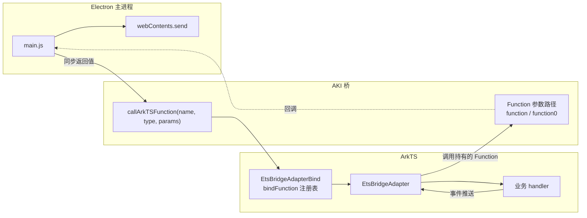
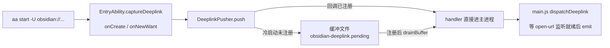

<!-- Copyright (c) 2026 HandwerSTD -->

# ArkTS 与 Electron 的双向通道

## 1. 背景

ObsidianHM 里 ArkTS 与 Electron 主进程之间需要交换数据。已有的通路是文件中转：ArkTS 写文件、外层 `main.js` 每 500ms 轮询读，deeplink 队列（`obsidian-deeplink.pending`）与检测更新（`update-check.json`、`update-check.now`）都走这条路。

v34.8.5 运行时的 `systemPreferences.callArkTSFunction` 提供了另一条通路。它承载于 AKI 框架（`libadapter.so`），官方接口文档见 openharmony-sig/electron 仓库 `docs/call-arkts-function-guide/README.md`。本文记录这条通道两个方向的实测结论，以及在这之上建立事件总线的方案。



## 2. 方向一：Electron 调 ArkTS

### 2.1 接口签名

```typescript
systemPreferences.callArkTSFunction(
  functionName: string,   // AKI 注册名，"模块名.方法名"
  returnType?: string,    // "void" | "number" | "boolean" | "string" | "string[]" | "number[]"
  paramArray?: any[]      // 每个元素对应一个 ArkTS 参数
): Promise<{ type: string, value: any }>
```

JS 端的 Promise 来自 C++ 线程池包装（`base::ThreadPool::PostTaskAndReplyWithResult`），被调用的 ArkTS 函数本身必须同步返回，不能声明为 `async`，也不能返回 `Promise<T>`。

### 2.2 类型映射与限制

| 项 | 规则 |
|----|------|
| 参数类型 | `number` / `boolean` / `string` / `Array<string>` / `Array<number>`；Object 被 `JSON.stringify` 降级为字符串透传，类型信息丢失 |
| 参数个数 | 2–3 个参数走强类型分发；4 个及以上全部退化为字符串传递 |
| 数组参数 | 仅单参数场景支持；2–3 参数场景只能传 `number` / `boolean` / `string`；空数组按 `string[]` 推断 |
| 传数组写法 | 外层 `paramArray` 的每个元素是一个参数，数组参数要再包一层：`[[1,2,3]]` 传一个数组，`[1,2,3]` 传三个 number |
| 返回值 | 仅上列六种；取返回值用 `.value` |
| AKI 校验 | 绑定名的 wrapper 函数签名必须与 Adapter 方法完全一致，类型不匹配在 C++ 侧断言失败 |

### 2.3 承载结构化数据的方式

逐方法注册 AKI 绑定的维护成本高，且类型限制多。做法是只注册一个入口，JSON 字符串承载全部结构化数据：

```typescript
// jsbindings/ArktsBusAdapterBind.ets
function busInvoke(method: string, payload: string): string {
    return implArktsBusAdapter().invoke(method, payload);
}
// bind: JsBindingUtils.bindFunction("Bus.Invoke", busInvoke);
```

`ArktsBusAdapter.invoke(method, payload)` 内部维护 `Map<string, (args: object) => object>` 注册表，payload 为 `{"args":[...]}`，返回 `{"ok":true,"result":...}` 或 `{"ok":false,"error":"..."}`。两个 `string` 参数加一个 `string` 返回值，全部落在强类型分发范围内，业务错误经 JSON 传回，与 AKI 层失败（Promise reject）不混淆。

JS 侧封装：

```javascript
async function arktsCall(method, ...args) {
    const raw = await electron.systemPreferences.callArkTSFunction(
        'Bus.Invoke', 'string', [method, JSON.stringify({ args })]);
    const parsed = JSON.parse(raw.value);
    if (!parsed.ok) throw new Error(parsed.error);
    return parsed.result;
}
```

检测更新可以借此迁移：关于页发问时 `await arktsCall('UpdateChecker.CheckNow')`，`update-check.json`、`update-check.now` 两个文件与两个 `setInterval` 全部删除，HTTP 请求改为请求时发起（方案见 `docs/update-check.md` 第 8 节）。

需要异步结果的能力（如云同步的 REST 请求），handler 立即返回 `{pending: id}`，真实结果经第 3 节的回调推送回来，JS 侧用 `id` 挂 Promise 映射表补全异步语义。

## 3. 方向二：ArkTS 推 Electron（回调机制）

### 3.1 机制

`callArkTSFunction` 的参数数组里可以传 JS Function。C++ 桥按原始函数的 `Function.length` 自动选择两种包装：

| JS 原始函数 | C++ 包装 | ArkTS 侧声明 |
|-------------|----------|--------------|
| 一个参数 `(v) => ...` | CallbackArgument | `(value: AkiValue) => void` |
| 零个参数 `() => ...` | VoidCallbackArgument | `() => void` |

ArkTS 拿到 Function 后可以随时调用，payload 直达主进程 V8。等效于一条 ArkTS 主动推 JS 的长连接。官方接口文档第五章「暂不支持传入 Function 类型参数」的描述已过时，以 `EtsBridgeAdapter.ets` 头注释与本节实测为准。

### 3.2 实测结论（v34.8.5，2026-10-16）

实测方法：`EtsBridgeAdapter` 第 8 节三个用例 + `main.js` 的 `callback-*` 探针，日志前缀 `[OHSV]`，写 `filesDir/obsidian.log`。

| 验证点 | 结果 | 证据 |
|--------|------|------|
| Function 参数注册 | 通过 | `callback probes registered`，无 `REGISTER REJECTED` |
| 回调可达性 + string payload | 通过 | 2 秒延迟后 `callback-reachability got "ets-callback-2000" typeof=string` |
| 同一 Function 多次调用 | 通过 | 两次调用都到达 |
| payload 类型保持 | 通过 | `got true typeof=boolean`、`got 12345 typeof=number`、`got "..." typeof=string` |
| 长期保活 | 通过 | 注册 30 秒后调用仍可达，`callback-long-delay got "ets-callback-after-30s" typeof=string`，Function 引用不被回收 |

已知限制（实测确认）：

- 回调 payload 仅支持 `undefined` / `null` / `boolean` / `number` / `string`，Object/Array 到 JS 侧是 `undefined`，结构化数据用 JSON 字符串承载。
- Function 参数只出现在总参数数不超过 3 个的调用里。
- 到达 ArkTS 侧的回调 `Function.length` 恒为 0（C++ 包装所致），function/function0 分支选择依据的是 JS 原始函数，wrapper 不能给 callback 加默认值或 rest 参数，那会把 `Function.length` 变成 0、导致 C++ 选错分支。
- `callArkTSFunction` 在 C++ 线程池线程执行 ArkTS 函数。当前实测过的回调都在纯计算路径上；handler 里调用依赖线程环境的系统 API 时逐个实测。

### 3.3 事件总线形态

JS 启动时把各事件的 handler 经 `callArkTSFunction` 传入 ArkTS 长期持有；ArkTS 在事件发生时直接调用：

```javascript
// JS 侧，窗口创建完成、asar 的 open-url 监听就绪之后再注册
await electron.systemPreferences.callArkTSFunction('Bus.Subscribe', 'void',
    ['deeplink', function (payload) {
        const { url } = JSON.parse(payload);
        dispatchDeeplink(url);
    }]);
```

```typescript
// ArkTS 侧
function busSubscribe(eventName: string, handler: (payload: string) => void): void {
    implArktsBusAdapter().subscribe(eventName, handler);
}
// 事件发生时（onNewWant 收到 obsidian:// 链接等）：
// handler(JSON.stringify({ url }));
```

主进程再按需 `webContents.send` 转发给渲染进程，可替换 `.hcs-login-pending` 这类文件握手。

注册时机注意：回调在主进程 ready 早期注册时，handler 里不能操作尚未创建的 `webContents`；正式实现的 `Bus.Subscribe` 在窗口创建完成后再注册，或 handler 内部自行判空。

### 3.4 已实施：deeplink 推送

deeplink 是事件总线的第一个落地场景，链路：



| 文件 | 职责 |
|------|------|
| `web_engine/src/main/ets/adapter/DeeplinkPusher.ets` | 持有 JS 回调；`push` 直推或写缓冲；`subscribe` 注册回调并排空缓冲 |
| `web_engine/src/main/ets/jsbindings/EtsBridgeAdapterBind.ets` 第 9 节 | `EtsBridge.SubscribeDeeplink` 绑定，wrapper 里取 `applicationContext.filesDir` |
| `electron/src/main/ets/utils/DeeplinkBridge.ets` | `extractAndStrip` 从 want 取链接并清除（防 initParameters 把它当起始页加载）；`push` 交给 pusher |
| `electron/src/main/ets/entryability/EntryAbility.ets` | `captureDeeplink` 调 `Inject.getOrCreate(DeeplinkPusher).push` |
| 外层 `main.js` | `subscribeDeeplink()` 在 `app.whenReady()` 后注册回调；`dispatchDeeplink` 保留原有的监听就绪等待与 `emittingFromQueue` 标志 |

实测（v34.8.5，2026-10-16）：`aa start -U 'obsidian://open?vault=test'` 热启动，日志依次命中 `deeplink pushed url=...`（ArkTS 推送）→ `正在派发 deeplink` → `已派发 deeplink`。文件队列轮询已删除，缓冲文件仅由 ArkTS 侧读写，冷启动期间的链接经 `drainBuffer` 补送。

## 4. 实测涉及到的文件

| 文件 | 改动 |
|------|------|
| `web_engine/src/main/ets/adapter/EtsBridgeAdapter.ets` | 第 8 节三个测试方法：`testCallbackString`（延迟可达性）、`testCallbackMultiTypes`（多次调用 + boolean/number payload）、`testCallbackLongDelay`（30 秒保活） |
| `web_engine/src/main/ets/jsbindings/EtsBridgeAdapterBind.ets` | 三个 wrapper 与 `EtsBridge.TestCallback*` 注册 |
| `web_engine/src/main/resources/resfile/resources/app/main.js` | `installVerifyProbes` 内的 `callback-*` 探针 |

相关文档：`docs/asar-customization-runtime.md` 第 11.3 节（通道归属判定）、`docs/runtime-inject-verification.md` 第 9.3 节（实测记录）、`docs/update-check.md`（检测更新迁移，已实施）、第 3.4 节（deeplink 推送，已实施）。
