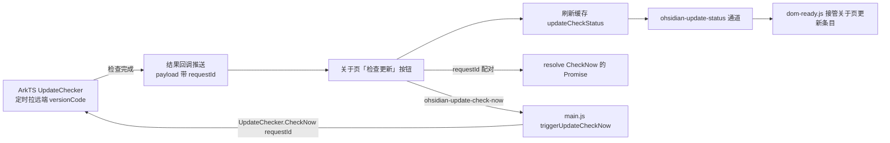

<!-- Copyright (c) 2026 HandwerSTD -->

# 检测更新

## 1. 机制



判定规则：远端 `app.versionCode` 大于本机时 `hasUpdate` 为真。

两条流量都走 `systemPreferences.callArkTSFunction`，全程无轮询：

- **结果推送（ArkTS → JS）**：JS 启动后经 `UpdateChecker.SubscribeUpdateResult` 注册持久回调，之后每次检查完成（定时检查与手动触发的检查都算）ArkTS 主动推结果，payload 带 `requestId`。
- **手动触发（JS → ArkTS）**：`triggerUpdateCheckNow()` 生成 `requestId`，把 `{resolve, reject, timer}` 存进 `pendingUpdateChecks` 映射表后调 `UpdateChecker.CheckNow`；结果推送到达时按 `requestId` 取回并 resolve，失败推送 reject，40 秒定时器兑底 ArkTS 侧异常失效。

定时检查的推送 `requestId` 为空串，只刷新缓存，不配对 Promise。

## 2. ArkTS 侧

`web_engine/src/main/ets/adapter/UpdateChecker.ets`，由 `WebAbility.onCreate` 调用 `startPolling`；AKI 绑定在 `web_engine/src/main/ets/jsbindings/UpdateCheckerBind.ets`，由 `JsBindingMethod.bind()` 注册。

| 项 | 值 |
|----|-----|
| 远端地址 | `https://raw.gitcode.com/handwer/ObsidianHM/raw/main/AppScope/app.json5` |
| 首次检查 | 启动后延迟 30 秒 |
| 检查间隔 | 6 小时（`setInterval`） |
| 结果存放 | 适配器实例字段 `lastResult`（内存） |
| AKI 绑定 | `UpdateChecker.SubscribeUpdateResult`（注册持久回调）、`UpdateChecker.CheckNow`（触发检查，参数 requestId） |
| 结果推送 | `checkOnce` 完成后经回调推 `{type:'result', requestId, result}`；失败时若来自 CheckNow 则推 `{type:'error', requestId, message}` |
| 解析 | `JSON.parse`，取 `app.versionCode` |
| 本机版本 | `bundleManager.getBundleInfoForSelfSync(GET_BUNDLE_INFO_DEFAULT).versionCode` |
| 网络权限 | `ohos.permission.INTERNET`，已在 `web_engine/src/main/module.json5` |

注册回调时已有结果会立即推一次，JS 侧据此初始化缓存。拉取与解析失败只记日志，不更新 `lastResult`，上一次的结果保留。

结果 JSON 结构：

```json
{
  "checkedAt": 1770000000000,
  "remoteVersionCode": 11404002,
  "localVersionCode": 11404001,
  "hasUpdate": true
}
```

`checkedAt` 是写入时刻的毫秒数，外层用它判断结果是否更新。

`GetStatus` 没有结果时返回空串。拉取与解析失败只记日志，不更新 `lastResult`，上一次的结果保留。

## 3. CheckNow 的同步边界

AKI 绑定要求 ArkTS 函数同步返回，而 HTTP 只有异步接口；同步等待完成（忙等或休眠）会阻塞 ArkTS 单线程事件循环，HTTP 完成回调永远进不来。因此 `CheckNow(requestId)` 只负责触发（调 `checkOnce(requestId)` 即返回），结果经结果回调推送回 JS，由 `pendingUpdateChecks` 映射表按 `requestId` 配对 resolve。实测从触发到 Promise resolve 约 650 毫秒（纯网络耗时）。

## 4. 解析远端清单

远端 `AppScope/app.json5` 由本仓库控制，约定保持纯 JSON（无注释、无尾逗号），因此直接用 `JSON.parse`。不必为此引入 JSON5 解析库：`@wolfx/json5` 是 bytecode HAR，引入它需要把工程级 `useNormalizedOHMUrl` 改为 true，会切换全工程的 ohmurl 格式。

解析位置在 `UpdateChecker.ets` 的 `checkOnce`。将来远端清单确实需要写注释时，在那里先剥离注释再解析，不要改 `useNormalizedOHMUrl`。

## 5. 外层

`web_engine/src/main/resources/resfile/resources/app/main.js`：

- `callArkts(method, returnType, params)` 是 `callArkTSFunction` 的封装，无参调用也要传空数组——`paramArray` 为 `undefined` 时运行时 reject（`Expected parameter array`）。
- `subscribeUpdateResult()` 在 `app.whenReady()` 后经 `UpdateChecker.SubscribeUpdateResult` 注册持久结果回调；`handleUpdateCheckPush` 解析推送，刷新 `updateCheckStatus` 缓存，并按 `requestId` 配对 resolve/reject。
- `triggerUpdateCheckNow()` 生成 `requestId`，返回在结果推送到达时 resolve 的 Promise；40 秒定时器兑底。
- ipcMain 通道 `ohsidian-update-status` 返回缓存，注册位置在 `loadApp()` 之后的通道注册区。通道名与官方无重名。
- ipcMain 通道 `ohsidian-update-check-now`（`installUpdateCheckNowChannel`）调 `triggerUpdateCheckNow()`，返回布尔值表示调用是否发起成功。该通道注册在同一区域，通道名与官方无重名。

## 6. 关于页显示

`inject/dom-ready.js` 的 `patchAbout()`。

官方 1.14.4 的「关于」页在版本项之后就是更新条目（平铺项 index 1）：名称由 `interface.label-update-available` 生成，`visible` 是比较渲染进程 Electron 版本的函数，`desc` 是一句说明加「了解更多」链接，`render` 造一个「下载」按钮打开 `obsidian.md/download`。本机 Electron 为 `5.0.0-Release`，那个比较恒为真，条目因此常显。

`patchAbout` 对这个条目做接管，不隐藏也不删除：

| 字段 | 接管后的值 |
|------|------------|
| `visible` | 函数，`sendSync('ohsidian-update-status')` 有结果且 `hasUpdate` 为真时显示 |
| `desc` | `createFragment` 加一段说明与「了解更多」链接，链接指向 `https://github.com/HandwerSTD/ObsidianHM/releases` |
| `render` | 保留官方实现（按钮文案仍是官方的「下载」），随后把按钮点击换成 `window.open` 到 releases |

定位方式是「平铺项 index 1 + 名称校验」，名称按中英两种语言比对（`可以更新`、`Update available`）；名称不符时再全表扫一遍，都找不到就放弃接管并记一条日志。接管排在插入「贡献作者」之前，那一步会把 index 1 占掉。

条目的 `visible` 每次渲染都会重新求值，因此在关于页停留时刷新一次页面即可看到最新结果。

### 6.1 「检查更新」按钮

版本行本身由官方维护，`render` 里调 `updateVersionSetting()` 重建按钮。`patchAbout` 在官方 render 之后把该按钮的 `clickCallback` 换成：

1. `sendSync('ohsidian-update-check-now')`，请外层触发 `UpdateChecker.CheckNow`；
2. 弹一条「正在检查更新...」提示；
3. 每 1 秒读一次 `ohsidian-update-status`，最多 30 次，`checkedAt` 变化即认为结果落地；
4. 调关于页对象的 `update()` 重画该页，更新条目的 `visible` 随之重算，然后提示「发现新版本」或「已是最新版本」。

按钮文案由 preload.js 的 i18n 覆盖控制。`setting.about.button-check-for-updates` 这个键已从覆盖表里移除，按钮取官方本地化文案（中文「检查更新」、英文 `Check for updates`）。

`update` 通道返回 `update-downloaded` 时（官方已下载好内核包），按钮由官方换成「重新启动」，此时不做替换。

## 7. 版本号编排

`AppScope/app.json5` 的 `versionCode` 是十进制整数，位数含义：

| 段 | 位数 | 含义 |
|----|------|------|
| major | 1 | Obsidian 主版本 |
| minor | 2 | Obsidian 次版本 |
| patch | 2 | Obsidian 修订号 |
| appPatch | 3 | 本项目自身的 bugfix 重发序号 |

当前 `versionCode` 是 `11404001`，按上面的分段读出 `1|14|04|001`，对应 `versionName` `1.14.4.1`。

本项目只改 AppScope 的 `versionCode` 与 `versionName`；`appPatch` 递增时 `versionName` 的第四段同步递增。
